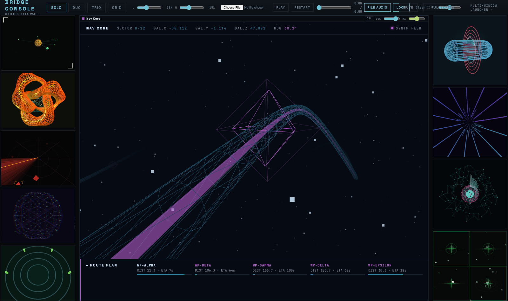
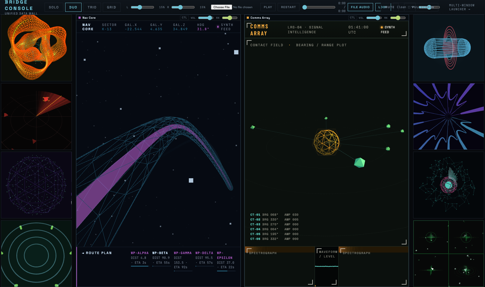
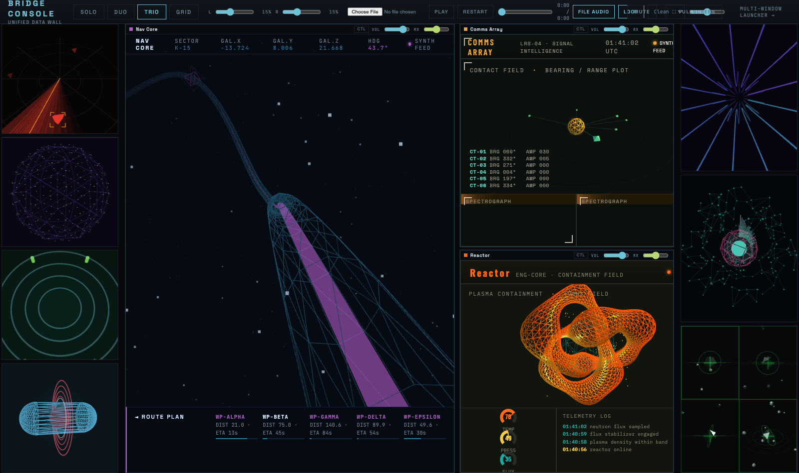
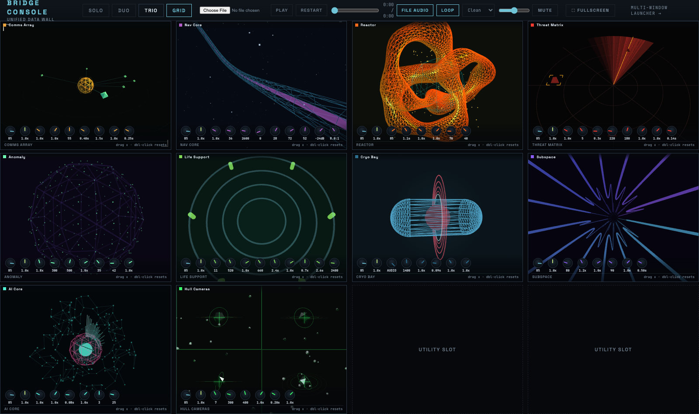

# Ship Data Screen Simulator


> Handing this to Claude Code (or another agent)? Start with **CLAUDE.md** /
> **AGENTS.md** (companion contributor briefs with conventions, hard
> constraints, and the shared audio API reference) and **ROADMAP.md** (the
> design record for each screen). This file covers setup and what's already
> built.
>
> This browser build is the **Phase-1 prototype**. Planning for a native
> desktop/plugin rebuild lives in **[docs/BUILD_PLAN_JUCE.md](docs/BUILD_PLAN_JUCE.md)**
> and **[docs/VISUAL_PLATFORMS.md](docs/VISUAL_PLATFORMS.md)**.

A set of 10 sci-fi ship data screens — each a self-contained HTML file with
3D animation (Three.js), a live spectrograph/waterfall, an oscilloscope, and
both **3D spatial** and **standard stereo** audio sonification.

Every screen reacts to **live sound** — your microphone, an **audio/video file
you drop in**, or (with no input at all) a procedural synth bed. On top of that,
each screen exposes a set of **live-tunable sonification parameters**, so you can
retune what the console actually *sounds* like on the fly.

Two ways to run them:

- **`app.html` — the Bridge Console** (default): all 10 screens on one wall in
  a single window. Pick a layout — **Solo / Duo / Trio** feature one, two, or
  three modules full-rate and full-volume in the center while the rest run as
  low-frame-rate previews on the side rails, or **Grid** shows all 10 at once as
  full-bleed visualizer thumbnails, each with a row of rotary **knobs** over the
  bottom for live tuning. Each pane has its own volume + reactivity and a **CTL**
  panel for live sound tuning; click a rail pane's ⤢ to promote it to center.
  Load an audio/video file in the top bar and every pane reacts to it, or hit
  **MUTE** to silence the whole wall while the visuals keep running. One "Engage
  Console" gesture boots audio in every pane at once. Use **FULLSCREEN** to
  switch the wall into true browser fullscreen (hides browser chrome).
- **`launcher.html` — the multi-window deck**: assign any screen to any of 10
  slots and pop each out as its own OS-level window to tile across a desktop.

## Bridge Console layouts

| Solo | Duo |
|---|---|
|  |  |

| Trio | Grid |
|---|---|
|  |  |

## Current highlights

- **Bridge Console wall:** Solo / Duo / Trio / Grid layouts, rail promotion,
  Grid spotlight focus, persistent panes, per-pane volume/reactivity, and
  master fullscreen/mute controls.
- **Live tuning:** every pane can expose module-specific CTL controls as sliders
  or Grid knobs. Recent additions include Life Support air-vent hiss controls
  and Cryo Bay selectable pod user-data waveforms.
- **Shared media drive:** load one audio/video file in the console and all ten
  screens analyse/react to it together while audible playback comes from only
  the primary pane.
- **Fallback synth:** when mic access is denied or absent, each screen falls
  back to the built-in procedural signal bed so the visualizers and sonification
  stay alive.
- **Modern dev loop:** Vite build/dev/preview, Vitest unit tests, Playwright
  browser regression tests, optional GA hook, and a lightweight Python static
  server fallback for the current screens.

## Tech stack

Everything runs in the browser through the project server. The app is now a
Vite multi-page project: top-level pages and every `screens/*.html` file are
treated as independent entries, while the existing screens still mostly use
their original plain-script/r128 Three.js style. New screens can use ES modules
and the npm `three` package.

| Layer | Technology | Notes |
|-------|-----------|-------|
| **Markup / styling** | HTML5, CSS3 | One self-contained `.html` per screen; all CSS inline. CSS Grid for layout, custom properties for each screen's palette tokens. |
| **Language** | Vanilla JavaScript (ES6+) | No framework, no TypeScript, no transpile. Screen logic is inline; only the audio engine is shared. |
| **Build / dev server** | [Vite 6](https://vite.dev/) | Multi-page app config: every top-level page and every `screens/*.html` file builds as an independent entry. Dev server runs on `http://localhost:8000`. |
| **3D rendering** | [Three.js](https://threejs.org/) | Existing screens load r128 as a global `THREE` from cdnjs; new work can import from the npm `three` package through Vite. |
| **Audio** | [Web Audio API](https://developer.mozilla.org/en-US/docs/Web/API/Web_Audio_API) | FFT analysis (`AnalyserNode`), 3D spatial audio via HRTF `PannerNode`, stereo pings via `StereoPannerNode`, procedural synth fallback via `OscillatorNode` + filtered `AudioBufferSourceNode` noise. Media/file playback routed through an effects chain (`BiquadFilter`, `DelayNode`, `ConvolverNode` reverb, modulated-delay chorus/flange, playback-rate pitch). |
| **Audio input** | `getUserMedia` (live mic), **dropped audio/video file**, or synth | Three interchangeable sources: live mic, a media file you load via the File Deck, or a procedural "deep space signal" synth bed. Falls back automatically to synth when no mic is available or permission is denied. |
| **2D drawing** | Canvas 2D | Spectrograph waterfall and oscilloscope are plain `<canvas>` + `CanvasRenderingContext2D`. |
| **Typography** | Google Fonts (CDN) | Per-screen display + mono pairings, assigned in ROADMAP.md so no two screens collide. |
| **Windowing** | `window.open()` | The launcher spawns each screen as a separate OS-level browser window for desktop tiling. |
| **Server API** | Vite plugin + Python fallback | `server/presets.js` provides `/api/health` and `/api/presets` under Vite; `server.py` provides the same lightweight API for static serving. |
| **Testing** | [Vitest](https://vitest.dev/) + [Playwright](https://playwright.dev/) | Unit tests cover preset storage; e2e tests cover Bridge Console spotlight, rail promotion, embedded layout, and module-control regressions. |
| **Optional analytics** | GA4 hook | `shared/analytics.js` no-ops until `VITE_GA_ID` is provided. |

**Shared code:** two plain, non-module scripts. [`shared/audio-engine.js`](shared/audio-engine.js)
(`window.ShipAudioEngine`) provides source acquisition (mic / media file /
synth), FFT/time-domain data, spatial voices, standard pings, the media-file
effects chain, a master **mute** at the output stage, and a self-injected **File
Deck** UI. [`shared/embed.js`](shared/embed.js) is the console hook activated by
`?embed=1` — it boots a screen on the shell's gesture and relays frame-rate,
volume, reactivity, mute, per-screen panel config, and "minimal" (thumbnail)
mode from the console. Screens are otherwise fully independent.

## Install packages

This repo now includes `package.json` and `package-lock.json`. Use Node
**20.11+**.

For a fresh clone or CI, install the locked package set:

```
npm ci
```

For local development when updating packages, `npm install` is also fine:

```
npm install
```

That installs:

| Package | Why it is needed |
|---------|------------------|
| `three` | npm Three.js package for modern/new module-based screens. |
| `vite` | local dev server, multi-page build, and static preview. |
| `vitest` + `happy-dom` | unit tests for Node/server-side logic. |
| `@playwright/test` | headless browser regression tests for the Bridge Console and screens. |

To run Playwright e2e tests on a machine that has not installed browser
binaries yet:

```
npm run test:e2e:install
```

## Quick start

**Recommended — Vite dev server:**

```
cd ship-screens
npm ci
npm run dev
```

Then open **http://localhost:8000/** in Chrome or Edge — it lands on the
**Bridge Console** (`app.html`). For the multi-window deck instead, open
**http://localhost:8000/launcher.html**.

**Static server fallback for the current screens:**

```
cd ship-screens
./serve.sh            # or: python3 server.py
```

The wrapper also serves on port 8000 and supports the launcher preset API. It
does not bundle npm/ES-module screen code, so use Vite for new module-based
work and production builds.

## Deploying to GitHub Pages

The build is fully static (`npm run build` → `dist/`) and works as-is on
[GitHub Pages](https://pages.github.com/), including from a project subpath
(`https://<user>.github.io/<repo>/`) — `vite.config.js` sets `base: './'` for
production builds so every asset resolves relatively.

**One-time setup:** in the repo's **Settings → Pages**, set **Source** to
**GitHub Actions**.

**[`.github/workflows/deploy-pages.yml`](.github/workflows/deploy-pages.yml)**
builds and publishes `dist/` automatically on every push to `main` (or via
**Actions → Deploy to GitHub Pages → Run workflow**).

What changes on Pages vs. local dev:

- **Live mic input works** — HTTPS on `*.github.io` is a secure context, same
  as `localhost`, unlike plain `file://`.
- **Saved Layouts stays hidden** — Pages is static hosting with no `/api/*`
  backend (`server.py` / the Vite presets plugin don't run there). The launcher
  already degrades gracefully for this (see `launcher.html`'s `initLayouts()`)
  — everything else works unchanged.

## Platform

- **Desktop OS**: macOS, Windows, and Linux (modern desktop browsers).
- **Browsers**: Chrome and Edge are the primary targets; Safari is supported
  (including fullscreen behavior).
- **Runtime:** serve through `npm run dev`, `npm run preview`, `./serve.sh`, or
  another localhost/static host. `file://` double-click support is no longer a
  target.
- **Secure context:** live microphone input requires `http://localhost` or
  another secure context. If mic access is denied or unavailable, every screen
  falls back to the procedural synth bed.

## Server

The primary development server is Vite:

```
npm run dev        # http://localhost:8000
npm run build      # static production build in dist/
npm run preview    # preview the built dist/
```

[`server.py`](server.py) is a **zero-dependency Python 3 standard-library**
server. It serves the current static screens and adds a small JSON API the
files can't provide alone.

**Launch:**

```
./serve.sh            # convenience wrapper — default port 8000
./serve.sh 9000       # custom port
python3 server.py     # equivalent, direct
PORT=9000 python3 server.py
```

Stop with `Ctrl+C`. It serves on `http://localhost:8000/launcher.html` by
default.

**Why serve locally?**

- **Live microphone** requires a "secure context" — `http://localhost` counts,
  `file://` does not. Serving unlocks real mic-reactive audio.
- **Saved launcher layouts** — assign screens to slots, name the arrangement,
  and reload it later. Stored server-side in `data/presets.json` (gitignored).
  The launcher's "Saved Layouts" bar only appears when the API is reachable.
- **Bundled/module screens** — Vite is required for screens that import npm
  packages or ES modules.

**API endpoints:**

| Method | Path | Purpose |
|--------|------|---------|
| `GET`  | `/api/health`  | `{ status, screens, presets }` liveness check |
| `GET`  | `/api/presets` | all saved launcher layouts |
| `POST` | `/api/presets` | save a layout — body `{ "name": str, "slots": [...] }` |

**Scripts:**

| File | What it is |
|------|-----------|
| [`server.py`](server.py) | The server itself (stdlib `http.server`). Run directly or via the wrapper. |
| [`serve.sh`](serve.sh) | One-line launcher: `cd`s to the project and runs `python3 server.py [port]`. |

## Using the Bridge Console (`app.html`)

The single-window data wall. All 10 screens load as embedded panes; you never
open separate windows.

- **Layouts** (top bar):
  - **Solo** — 1 hero + rails · **Duo** — 2 features + rails · **Trio** — hero +
    2 stacked + rails. Switching between these keeps your current featured order.
  - **Grid** — all 10 screens at once as a 4×3 wall. Each cell is a **full-bleed
    visualizer** (text chrome hidden, mid frame rate) with a transparent **knob
    panel** overlaid across the bottom: a row of rotary knobs (module volume,
    reactivity, then every one of that screen's sonification parameters) above an
    **info box** that shows the details of whichever knob you hover — its label,
    live value, and range. Drag a knob vertically to change it; double-click to
    reset it to default. The panel is see-through, so the visual stays the whole
    cell and the controls just mask it.
  - **Grid spotlight** — click a grid thumbnail to enlarge it over the wall
    without reloading the iframe; the knob panel scales up with it. Press
    Escape, click the backdrop, or use the close button to return to Grid.
- **Engage Console** — one click boots audio in every pane at once (browsers
  require a user gesture to start audio; the console needs only one for all 10).
- **Center vs. rails** — featured (center) panes render at full frame rate
  (60fps) and louder; rail panes render at a low frame rate (12fps) and quieter,
  to stay within the browser's WebGL-context and CPU budget. Grid thumbnails run
  at an intermediate rate (24fps).
- **Per-pane volume + reactivity** — every pane's title bar has a **VOL** slider
  and an **RX** (audio-reactivity) slider that scales how strongly that screen's
  visuals respond to the audio (0×–2×).
- **CTL panel** — each pane's **CTL** button opens a popover of that screen's
  live-tunable **sonification parameters** (e.g. Comms Array's beacon pitch/gain,
  ping rate/pitch/length and spike threshold; Threat Matrix's sweep speed, threat
  count and ping gain). Changes apply instantly with no reboot. See
  [Per-screen sound tuning](#per-screen-sound-tuning) below.
- **Media / File Deck** (top bar) — load an audio or video file and every pane
  reacts to *it* instead of the mic/synth. Play/restart, seek, loop, mute the
  file's own audio ("File Audio"), and apply a pass-through effect (Clean,
  Filter, Delay, Reverb, Chorus, Flange, Pitch) with an amount slider.
  To avoid layered playback from 10 simultaneous engines, the file's own
  audible output is routed through the current primary pane only; all panes
  still analyse and react to the same file.
- **MUTE** (top bar) — a master mute that silences every pane at once (the
  button turns red "MUTED"). It cuts sound at each engine's final output stage,
  so the **visualizers keep running** — the wall stays alive, just silent.
- **FULLSCREEN** (top bar) — toggles true browser fullscreen for the entire
  wall (document-level fullscreen with Safari fallbacks).
- **Rail width** — L/R sliders in the top bar resize the side rails (8%–28%).
- **Promote** — click a rail pane's **⤢** to swap it into the primary center
  slot (the previous hero drops back to the rail). No reload — panes never
  re-boot when you rearrange them.
- Your layout, order, volumes, reactivity, mute state, and per-screen panel
  settings persist in `localStorage`. Preference migrations keep older saved
  console states aligned when new module controls are added.

How it works: each screen is loaded in an `<iframe>` with `?embed=1`, which
activates [`shared/embed.js`](shared/embed.js) — it hides the screen's own boot
overlay/controls and lets the console drive boot, frame rate, volume,
reactivity, mute, per-screen panel config, and "minimal" thumbnail mode. The
panes are positioned by CSS and never reparented, so rearranging the wall never
reloads (or re-boots) a screen.

## Feed your own audio (File Deck)

Every screen can be driven by an audio or video file instead of the mic or synth
bed — drop in a track and the 3D scene, spectrograph, oscilloscope, and
sonification all react to it.

- **In the Bridge Console:** use the media controls in the top bar (above). One
  file drives every pane.
- **On a standalone screen:** each screen auto-injects a small **File Deck**
  panel (bottom-left) after boot. Pick a file, then use its transport (play /
  restart / seek / loop), toggle whether the file's own audio is audible, set an
  **audio-reactivity** amount, choose a pass-through **effect** (Clean, Filter,
  Delay, Reverb, Chorus, Flange, Pitch) with a cutoff/amount control, and use
  **Mute Output** to silence that screen entirely (visuals keep running).

The engine analyses the file exactly like a mic feed, so the visuals stay
FFT-driven — you're just choosing what sound they listen to.

## Per-screen sound tuning

Beyond volume, each screen exposes a small set of **sonification parameters** you
can retune live — pitch, gain, trigger thresholds, ping/klaxon rates, animation
speeds, and so on — so the same screen can range from a quiet ambient drone to an
aggressive alert console. In the Bridge Console these appear two ways:

- **Solo / Duo / Trio** — behind each pane's **CTL** button, as a popover of
  labelled sliders.
- **Grid** — as the row of rotary **knobs** overlaid on each thumbnail, with an
  info box beneath that names the hovered knob and shows its value and range.

Both surfaces are driven by the same reusable knob/panel code and the screen's
`window.__shipPanelConfig(cfg)` hook (relayed by `embed.js`). Parameters are
per-screen — Reactor exposes breach threshold and klaxon rate/pitch; Nav Core
exposes route speed, oscillator pitch, PWM depth and a compressor; Life Support
adds tunable air-vent hiss controls; Cryo Bay adds a `User Data` selector for
pod mini-waveforms (`ECG`, `STAB`, `TEMP`, `AUDIO`).

## Using the launcher

- Each of the 10 slots has a dropdown of available screens and an **Open** /
  **Close** button. All 10 roadmap screens are online.
- **Open** spawns that screen in its own window (not a tab) so you can
  drag/resize/tile it independently — position several across one or more
  monitors to build a full console.
- Re-clicking **Open** on a slot that's already open just focuses that window
  rather than duplicating it.
- **Open All Assigned** launches every slot currently pointed at a built
  screen in one go.
- **Saved Layouts** appears when running through Vite or `server.py` /
  `serve.sh`:
  save the current slot assignment by name, then reload it later from the
  preset list (`/api/presets`).

## Status

| # | Screen | Concept | Status |
|---|--------|---------|--------|
| 1 | Comms Array | Long-range signal intelligence: 3D contact constellation, spectrograph waterfall, spatial + standard sonification | ✅ built |
| 2 | Nav Core | Stellar cartography: full-bleed starfield, glowing route tube, camera drift, beacon bearings | ✅ built |
| 3 | Reactor | Engineering telemetry: bass-driven containment torus, thermal spectrograph, industrial klaxons | ✅ built |
| 4 | Threat Matrix | Tactical targeting: rotating 3D sweep, deterministic ping on sweep-crossing, hostile drones | ✅ built |
| 5 | Anomaly | Xenoscience: transient-detection RGB-split glitch, ephemeral spatial contacts, jittering chrome | ✅ built |
| 6 | Life Support | Atmospherics: breathing deck ring, zone alarms, tunable air-vent hiss | ✅ built |
| 7 | Cryo Bay | Medical stasis: pod tiles, selectable user-data waveforms, positional heartbeat beeps | ✅ built |
| 8 | Subspace | Warp harmonics: standing-wave field-line tunnel, harmonic-series tones, Lissajous XY scope | ✅ built |
| 9 | AI Core | Neural substrate: node-graph cascades, radial spectrograph, position-hashed thought blips | ✅ built |
| 10 | Hull Cameras | External optical: one debris scene in a 2×2 viewport grid, proximity alerts | ✅ built |

All 10 screens are built. To add an 11th, drop it in `screens/`, register it in
both `launcher.html` (`SCREENS`) and `app.html` (`MODULES`), and include
`shared/embed.js` so it works in the console (see CLAUDE.md).

## Architecture

```
ship-screens/
  index.html               redirect → app.html
  app.html                 Bridge Console — single-window data wall (default)
  launcher.html            multi-window control deck — assigns & spawns windows
  server.py / serve.sh     zero-dependency Python app server (+ presets API)
  package.json             Vite/Vitest/Playwright scripts
  vite.config.js           multi-page Vite build + presets API plugin
  playwright.config.js     headless browser regression tests
  CLAUDE.md / AGENTS.md     agent/contributor guides — conventions, current
                            implementation notes, and hard constraints
  ROADMAP.md               per-screen design brief for all 10 screens
  docs/
    BUILD_PLAN_JUCE.md      native rebuild — JUCE audio engine + Main Window
                            build plan (standalone + VST3/AU)
    VISUAL_PLATFORMS.md     survey of algorithmic/node-based visual engines
                            for the richer native visualizer layer
  server/
    presets.js              Vite plugin reproducing server.py's /api/presets
                            and /api/health endpoints under `npm run dev`
  shared/
    audio-engine.js        shared Web Audio backbone: mic / media-file / synth
                            sources, FFT analysis, HRTF spatial voices, standard
                            pings, media effects chain, self-injected File Deck UI
    embed.js               console hook — boot / fps / volume / reactivity /
                            panel / minimal-mode control when ?embed=1
    analytics.js           optional GA4 hook — no-ops until VITE_GA_ID is set
  screens/
    screen-01-comms-array.html
    ... through screen-10-hull-cameras.html
  tests/
    unit/                   Vitest specs for server-side logic
    e2e/                    Playwright specs for console/browser behavior
```

`shared/audio-engine.js` and `shared/embed.js` are still plain scripts for the
current screens, while Vite supplies the server/build layer and allows future
screens to import npm packages. Each screen is otherwise fully self-contained:
its own HTML/CSS/3D scene/canvas drawing code, built around a **distinct visual
identity** rather than a shared template — by design, no two screens should look
like reskins of each other.

## Screen 1: Comms Array

**Concept:** a signal-intelligence / long-range sonar console — amber
phosphor and worn-terminal in feel, deliberately not the generic glossy-cyan
holographic sci-fi look.

- **3D:** a central ship-core wireframe icosahedron surrounded by 6 drifting
  "contact" nodes on a bearing/range plot, connected to the core by trace
  lines. Node position, pulse, and glow are driven by the live FFT data
  sliced per-contact.
- **Spectrograph:** twin scrolling amber waterfalls flanking the waveform
  panel (left and right), both driven by the same
  `AnalyserNode.getByteFrequencyData` row so they scroll in lockstep.
- **Oscilloscope:** cyan waveform + amber level meter in the center of the
  bottom row, driven by `getByteTimeDomainData`.
- **Spatial sonification (toggle):** each contact gets a persistent HRTF
  `PannerNode` voice positioned to match its 3D location — put on
  headphones and you can hear contacts move around you.
- **Standard sonification (toggle):** independent of spatial mode, contacts
  above an amplitude threshold trigger short stereo-panned "ping" tones.

## Notes for future screens

Each new screen should get its own token system (palette / type / signature
motif) per the project's design approach — reuse the *engine*
(`shared/audio-engine.js`), never the *look*.
